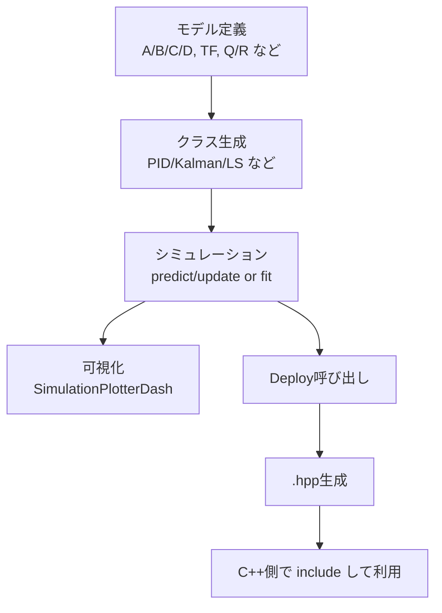

# 概要と全体フロー

このページでは、`python_control` の使い方を「サンプル実装の流れ」で俯瞰します。

## 1. このリポジトリでの位置づけ

`python_control` 配下には、主に「Pythonで定義した制御モデルをC++へ展開する」ための Deploy クラスがあります。

一方で、制御クラス本体（PID/Kalman/最小二乗など）は主に `external_libraries/MCAP_python_control` の実装を利用します。

そのため実運用の流れは次の2段構成になります。

1. Pythonでモデルや制御器を構築・検証する
2. Deploy クラスで C++ ヘッダを自動生成する

## 2. サンプルコード共通の実行フロー

## 3. サンプル分類

| フォルダ | 主な内容 | 代表API |
|---|---|---|
| `sample/transfer_function` | 離散伝達関数の定義と応答確認 | `TransferFunctionDeploy.generate_transfer_function_cpp_code` |
| `sample/state_space` | 状態空間モデルの離散化・応答確認 | `StateSpaceDeploy.generate_state_space_cpp_code` |
| `sample/pid_controller` | PID制御の逐次更新 | `DiscretePID_Controller.update` / `DiscretePID_ControllerDeploy.generate_PID_cpp_code` |
| `sample/lqr` | LQR/LQIゲイン計算と追従制御 | `LQR_Deploy.generate_LQR_cpp_code` / `LQI_Deploy.generate_LQI_cpp_code` |
| `sample/kalman_filter` | LKF/EKF/UKF の推定ループ | `KalmanFilterDeploy.generate_LKF/EKF/UKF_cpp_code` |
| `sample/least_squares` | バッチLSと逐次RLS推定 | `LeastSquaresDeploy.generate_LS_cpp_code` / `generate_RLS_cpp_code` |

## 4. 「使い方」を読むときのポイント

- クラス内部アルゴリズムよりも、**入出力の形状と更新順序**を重視してください
- Deployは「Pythonで確認済みモデル」をC++へ移す段階で使います
- `number_of_delay` を使うサンプル（Kalman, StateSpace, TransferFunction）は、遅延系の実装例です

次は、まず利用頻度が高い `transfer_function / state_space / pid_controller` の使い方を見ます。
[基本クラスの使い方（伝達関数・状態空間・PID）](./02_basic_classes_transfer_state_pid.md)

