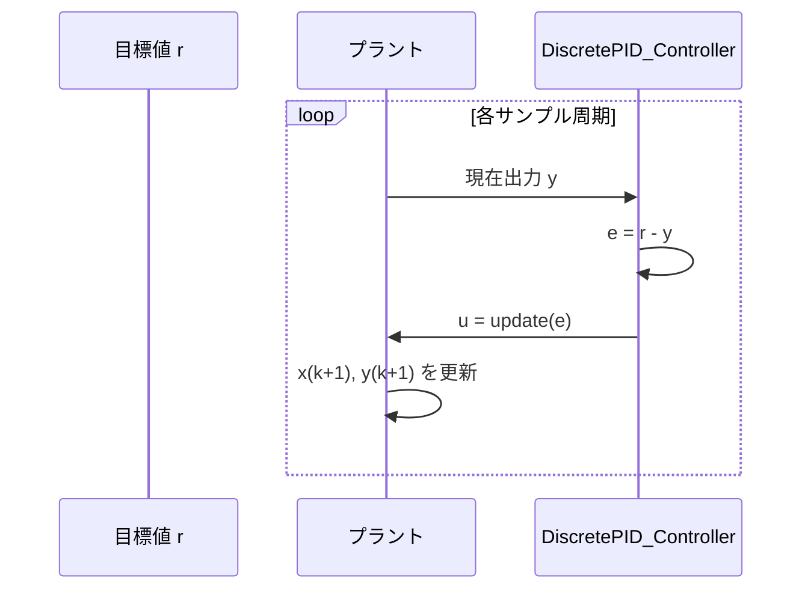

# 基本クラスの使い方（伝達関数・状態空間・PID）

このページでは以下のサンプルをもとに、基本的な実装パターンを整理します。

- `sample/transfer_function/*.py`
- `sample/state_space/*.py`
- `sample/pid_controller/*.py`

---

## 1. 離散伝達関数（Transfer Function）

### 対応サンプル

- `sample/transfer_function/discrete_transfer_function_2_4.py`
- `sample/transfer_function/discrete_transfer_function_3_4.py`
- `sample/transfer_function/discrete_transfer_function_4_4.py`

### 実装パターン

1. `control.TransferFunction` で連続系または離散系を作る
2. 必要に応じて `sample(Ts=..., method='zoh')` で離散化
3. `TransferFunctionDeploy.generate_transfer_function_cpp_code(...)` でヘッダ生成
4. `control.step_response` で応答比較（TF と `tf2ss` の比較を含む）

### 最小コード例

```python
import control
from python_control.transfer_function_deploy import TransferFunctionDeploy

sys_d = control.TransferFunction([0.5, 0.3, 0.1], [1.0, -1.8, 1.5, -0.7, 0.2], dt=0.2)
deployed_file_names = TransferFunctionDeploy.generate_transfer_function_cpp_code(
    sys_d,
    number_of_delay=0
)
print(deployed_file_names)
```

---

## 2. 離散状態空間（State Space）

### 対応サンプル

- `sample/state_space/discrete_state_space_1.py`
- `sample/state_space/discrete_state_space_2.py`

### 実装パターン

1. `A, B, C, D` を `numpy` で定義
2. `control.ss(...)` または `control.StateSpace(...)` でモデル化
3. 連続系の場合は `sample` / `c2d` で離散化
4. `StateSpaceDeploy.generate_state_space_cpp_code(...)` を呼ぶ
5. 応答やシミュレーションループで挙動確認

### 最小コード例

```python
import numpy as np
import control
from python_control.state_space_deploy import StateSpaceDeploy

A = np.array([[0.7, 0.2], [-0.3, 0.8]])
B = np.array([[0.1], [0.2]])
C = np.array([[2.0, 0.0]])
D = np.array([[0.0]])
dt = 0.01

sys_d = control.ss(A, B, C, D, dt)
deployed_file_names = StateSpaceDeploy.generate_state_space_cpp_code(
    sys_d,
    number_of_delay=0
)
print(deployed_file_names)
```

---

## 3. 離散PID制御

### 対応サンプル

- `sample/pid_controller/discrete_pid_controller.py`
- `sample/pid_controller/servo_motor_pid_control.py`

### 実装パターン

`DiscretePID_Controller` は「誤差 `e` を `update(e)` に渡して制御入力を得る」使い方です。



### 最小コード例

```python
from external_libraries.MCAP_python_control.python_control.pid_controller import DiscretePID_Controller
from python_control.pid_controller_deploy import DiscretePID_ControllerDeploy

pid = DiscretePID_Controller(
    delta_time=0.2,
    Kp=1.0, Ki=0.1, Kd=0.5,
    N=5.0,
    Kb=0.1,
    minimum_output=-0.2,
    maximum_output=0.2
)

u = pid.update(0.3)  # 誤差を入力
deployed_file_names = DiscretePID_ControllerDeploy.generate_PID_cpp_code(pid)
print(u, deployed_file_names)
```

### 補足

- `servo_motor_pid_control.py` は、ノイズやオフセットを入れた現実的なループ例です
- 出力制限（`minimum_output`, `maximum_output`）は実機向けに重要です

---

次は、LQR/LQI・Kalman・最小二乗の実装パターンです。
[応用クラスの使い方（LQR/LQI・Kalman・最小二乗）](./03_advanced_classes_lqr_kalman_least_squares.md)

