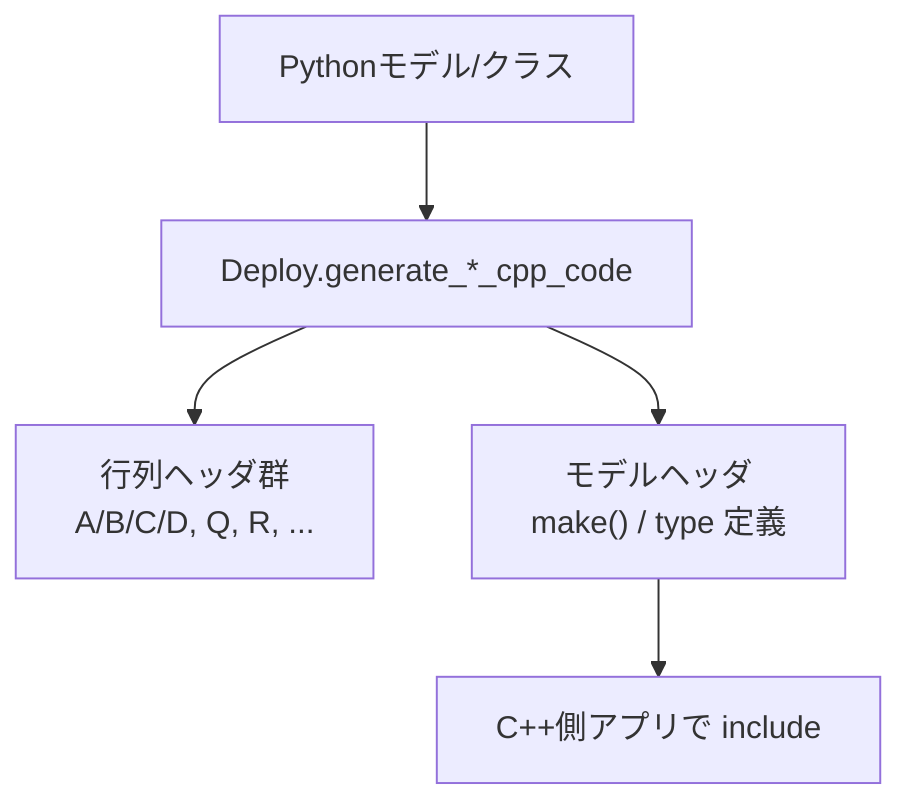

# コード生成（Deploy）実践ガイド

このページは `python_control/*.py` の Deploy クラスを対象に、
「どの入力を渡すと、どの種類の `.hpp` が生成されるか」を整理します。

生成されたヘッダをC++側でどう使うか（クラスAPIの説明）は
[Pythonクラスに対応するC++クラスとインターフェース](./06_cpp_class_interfaces.md) を参照してください。

---

## 1. Deployクラス一覧

| Deployクラス | 主な入力 | 主な用途 |
|---|---|---|
| `TransferFunctionDeploy` | `control.TransferFunction` | 離散伝達関数のC++化 |
| `StateSpaceDeploy` | `control.StateSpace` | 離散状態空間モデルのC++化 |
| `DiscretePID_ControllerDeploy` | `DiscretePID_Controller` | PIDパラメータ定義のC++化 |
| `LQR_Deploy` | `A, B, Q, R` | LQR設定のC++化 |
| `LQI_Deploy` | `A, B, C, Q_ex, R_ex` | LQI設定のC++化 |
| `KalmanFilterDeploy` | `LKF/EKF/UKFインスタンス` | Kalman推定器のC++化 |
| `LeastSquaresDeploy` | `LeastSquares` / `RecursiveLeastSquares` | LS/RLS設定のC++化 |

---

## 2. 基本呼び出しパターン

```python
deployed_file_names = SomeDeployClass.generate_xxx_cpp_code(target_object, ...)
print(deployed_file_names)
```

多くの Deploy 関数は「生成したファイル名のリスト」を返します。
生成物は、**モデル本体ヘッダ + 必要に応じて行列ヘッダ**の複数ファイルになります。

---

## 3. 生成ファイルの構成イメージ



### 例

- `StateSpaceDeploy` は A/B/C/D の行列ヘッダを生成し、それらを include する状態空間ヘッダを生成します
- `KalmanFilterDeploy`（特に EKF/UKF）は、パラメータ型・状態方程式・観測方程式などの補助ヘッダを合わせて生成します

---

## 4. 命名ルールの実務上の注意

多くの Deploy 関数は、次の情報を使って出力名を決めます。

- 呼び出し元ファイル名
- 引数に渡した変数名（オブジェクト参照）

そのため、可読性の高い名前をつけるのがおすすめです。

```python
# 例: 変数名がそのまま生成名に反映されるケースがある
sys_d = control.TransferFunction(...)
TransferFunctionDeploy.generate_transfer_function_cpp_code(sys_d)
```

---

## 5. number_of_delay の扱い

`TransferFunctionDeploy` / `StateSpaceDeploy` / `KalmanFilterDeploy` などでは
`number_of_delay` を指定できます。

- `0`: 遅延なし
- `1以上`: 遅延段数を持つモデルとして型定義に反映

Python側シミュレーションの遅延表現と、C++実装時の遅延段数を一致させてください。

---

## 6. EKF/UKF のコード生成フロー（実践）

EKF/UKFサンプルでは次の順序で作業します。

1. `sympy` で状態方程式・観測方程式（EKFはヤコビアン含む）を定義
2. `ExpressionDeploy.write_*_from_sympy` でPython関数コードを生成
3. `exec` で関数をロードしてフィルタを構築
4. `KalmanFilterDeploy.generate_EKF_cpp_code` / `generate_UKF_cpp_code` でC++化

この流れにより、非線形モデルの式定義とC++移植を同じソース定義から一貫して行えます。

---

## 7. C++側への取り込みイメージ

Deployが返したヘッダをプロジェクトに配置し、生成された名前空間の `make()` を呼び出して使います。

> 具体的なビルド設定はプロジェクト構成に依存しますが、
> サンプルの目的は「Pythonで検証した制御器設定を、そのままC++定義へ落とす」ことです。

---

補助的な可視化や外部ライブラリの役割は次を参照してください。
[可視化と補助ライブラリの役割](./05_visualization_and_external_libraries.md)
