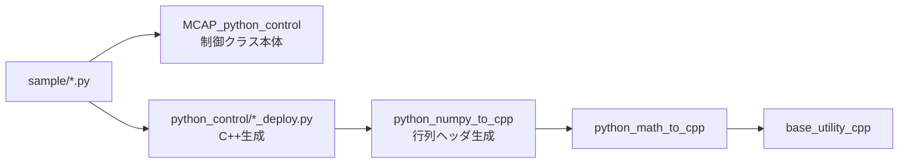

# 可視化と補助ライブラリの役割

このページでは、サンプルで頻出する可視化クラスと、外部ライブラリの役割を簡潔にまとめます。

---

## 1. SimulationPlotterDash の使い方

`sample` の多くのコードで、結果確認に `SimulationPlotterDash` が使われています。

### 基本手順

1. `plotter = SimulationPlotterDash()` を作る
2. ループ内で `append` / `append_name` で信号を追加
3. `assign(...)` でサブプロット配置を指定
4. `plot(...)` で表示

### 典型例

```python
plotter.append_name(x_true, "x_true")
plotter.append_name(x_est, "x_est")

plotter.assign("x_true", row=0, column=0, position=(0, 0), x_sequence=time, label="true")
plotter.assign("x_est", row=0, column=0, position=(0, 0), x_sequence=time, label="estimated")

plotter.plot("estimation result")
```

---

## 2. 外部ライブラリの役割（本リポジトリでの使われ方）

| ライブラリ | 主な役割 | 本リポジトリでの利用ポイント |
|---|---|---|
| `external_libraries/MCAP_python_control` | 制御クラス本体（PID/Kalman/LSなど） | `sample` から直接インポートして更新ループを実行 |
| `external_libraries/python_numpy_to_cpp` | NumPy行列のC++コード生成補助 | Deploy内部で行列ヘッダ生成に使用 |
| `external_libraries/python_math_to_cpp` | 数値演算（math相当）をC++で提供 | 生成されたC++制御コードの数値計算基盤 |
| `external_libraries/base_utility_cpp` | ゼロ除算回避・コピー等の基盤ユーティリティ | 数値ライブラリ/行列ライブラリの下支え |

---

## 3. 役割関係のイメージ



---

## 4. 実務での使い分け

- **アルゴリズム検証フェーズ**
  `sample` と同様に Python クラスを直接回して挙動確認
- **C++実装フェーズ**
  Deploy で `.hpp` を生成し、C++側に組み込む
- **チューニングフェーズ**
  Pythonでゲインやノイズ共分散を調整し、再生成して反映

この流れを回すことで、検証と実装の差分を小さく保てます。

