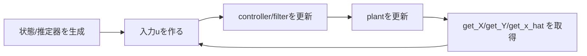

# Pythonクラスに対応するC++クラスとインターフェース

このページでは、Python側で設計・検証した制御モデルが、C++側ではどのクラス/関数に対応するかを整理します。
アルゴリズム内部ではなく、**使い方とインターフェース**に焦点を当てます。

---

## 1. 対応表（Python → C++）

| Python側の主な利用 | C++側の主な型/関数 | 典型的な呼び方 |
|---|---|---|
| `control.TransferFunction` + `TransferFunctionDeploy` | `DiscreteTransferFunction` / `make_DiscreteTransferFunction` | `system.update(u)`, `system.get_y()` |
| `control.StateSpace` + `StateSpaceDeploy` | `DiscreteStateSpace` / `make_DiscreteStateSpace` | `sys.update(u)`, `sys.get_X()`, `sys.get_Y()` |
| `DiscretePID_Controller` + `DiscretePID_ControllerDeploy` | `DiscretePID_Controller` / `make_DiscretePID_Controller` | `u = pid.update(error)` |
| `LQR_Deploy` | `LQR` / `make_LQR` | `K = lqr.solve()`, `lqr.get_K()` |
| `LQI_Deploy` | `LQI` / `make_LQI` | `K = lqi.solve()`, `lqi.get_K()` |
| `LinearKalmanFilter` + `KalmanFilterDeploy.generate_LKF_cpp_code` | `LinearKalmanFilter` / `make_LinearKalmanFilter` | `predict/update` or `predict_and_update` |
| `ExtendedKalmanFilter` + `KalmanFilterDeploy.generate_EKF_cpp_code` | `ExtendedKalmanFilter` (`ExtendedKalmanFilter_Type`) | `ekf.predict(u)`, `ekf.update(y)` |
| `UnscentedKalmanFilter` + `KalmanFilterDeploy.generate_UKF_cpp_code` | `UnscentedKalmanFilter` (`UnscentedKalmanFilter_Type`) | `ukf.predict(u)`, `ukf.update(y)` |
| `LeastSquares` + `LeastSquaresDeploy.generate_LS_cpp_code` | `LeastSquares` / `make_LeastSquares` | `ls.fit(X,Y)`, `ls.predict(X)` |
| `RecursiveLeastSquares` + `LeastSquaresDeploy.generate_RLS_cpp_code` | `RecursiveLeastSquares` / `make_RecursiveLeastSquares` | `rls.update(x,y)` |

---

## 2. C++側の基本ヘッダ

通常は次の集約ヘッダを使えば、制御系クラスをまとめて利用できます。

```cpp
#include "python_control.hpp"
```

必要に応じて行列/線形代数のヘルパとして `python_numpy.hpp` を併用します。

---

## 3. クラス別インターフェース（実務でよく使うもの）

### 3.1 DiscreteTransferFunction

- 生成: `make_DiscreteTransferFunction(...)`
- 更新: `update(u)`
- 出力取得: `get_y()`
- 状態取得: `get_X()`
- 係数差し替え: `reset_numerator_and_denominator(...)`

```cpp
auto numerator = make_TransferFunctionNumerator<4>(...);
auto denominator = make_TransferFunctionDenominator<5>(...);
auto tf = make_DiscreteTransferFunction<2>(numerator, denominator, 0.2); // 遅延2段

tf.update(1.0);
double y = tf.get_y();
```

### 3.2 DiscreteStateSpace

- 生成: `make_DiscreteStateSpace(...)`
- 更新: `update(U)`
- 状態取得: `get_X()`
- 出力取得: `get_Y()`
- 状態リセット: `reset_state()`

```cpp
auto sys = make_DiscreteStateSpace(A, B, C, D, 0.01);
auto u = make_StateSpaceInput<1>(1.0);
sys.update(u);
auto x = sys.get_X();
auto y = sys.get_Y();
```

### 3.3 DiscretePID_Controller

- 生成: `make_DiscretePID_Controller(...)`
- 更新: `update(error)`
- 内部状態リセット: `reset()`

```cpp
auto pid = make_DiscretePID_Controller(
    0.2, 1.0, 0.1, 0.5, 5.0, 0.1, -0.2, 0.2
);
double u = pid.update(error);
```

### 3.4 LQR / LQI

- 生成: `make_LQR(...)` / `make_LQI(...)`
- ゲイン計算: `solve()`
- ゲイン取得: `get_K()`

```cpp
auto lqr = make_LQR(A, B, Q, R);
auto K = lqr.solve();
K = lqr.get_K();
```

```cpp
auto lqi = make_LQI(A, B, C, Q_ex, R_ex);
auto K_ex = lqi.solve();
K_ex = lqi.get_K();
```

### 3.5 LinearKalmanFilter

- 生成: `make_LinearKalmanFilter(state_space, Q, R)`
- 推定: `predict(u)`, `update(y)`, `predict_and_update(u,y)`
- 固定ゲイン運用: `converge_G()`, `predict_and_update_with_fixed_G(...)`
- 推定状態取得: `get_x_hat()`, `get_x_hat_without_delay()`

```cpp
auto lkf = make_LinearKalmanFilter(sys, Q, R);
lkf.set_x_hat(make_StateSpaceState<4>(0.0, 0.0, 0.0, 0.0));
lkf.predict_and_update(u, y_measured);
auto x_hat = lkf.get_x_hat();
```

### 3.6 ExtendedKalmanFilter / UnscentedKalmanFilter

EKF/UKFは、状態方程式・観測方程式（EKFはヤコビアンも）を持つ関数オブジェクトとパラメータを受け取る構成です。  
共通インターフェースは次です。

- `predict(u)`
- `update(y)`
- `get_x_hat()`
- `get_x_hat_without_delay()`

Deployで生成したヘッダを使う場合、通常は生成ヘッダ側の `make()` でインスタンス化できます。

### 3.7 LeastSquares / RecursiveLeastSquares

**LeastSquares**

- 生成: `make_LeastSquares<X_Type>()`
- 学習: `fit(X, Y)`
- 推論: `predict(X)`
- 係数取得: `get_weights()`

**RecursiveLeastSquares**

- 生成: `make_RecursiveLeastSquares<X_Type>(lambda, delta)`（省略可）
- 逐次更新: `update(x_row, y_true)`
- 推論: `predict(x_row)`
- 係数取得: `get_weights()`

---

## 4. Deploy生成ヘッダを使うときの呼び出し形

Deployで生成されたヘッダには、基本的に次のような構造が含まれます。

- `using type = ...`
- `inline auto make(void) -> type`

そのため、C++側では次のように使えます。

```cpp
#include "generated_model_header.hpp"

auto model = generated_model_header::make();
```

この形を使うと、Pythonで定義した係数・行列サイズ・遅延段数を、そのままC++側へ受け渡せます。

---

## 5. 典型ループ（C++実装側）



このループ構造は、`sample/*.cpp` の実装パターンと一致します。

